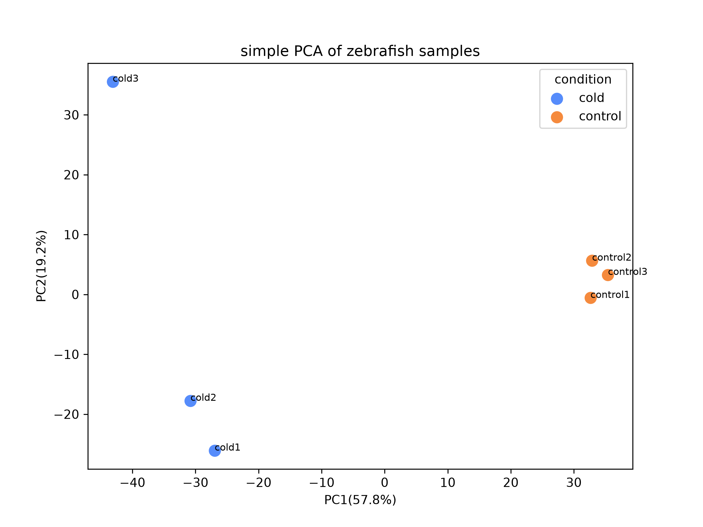
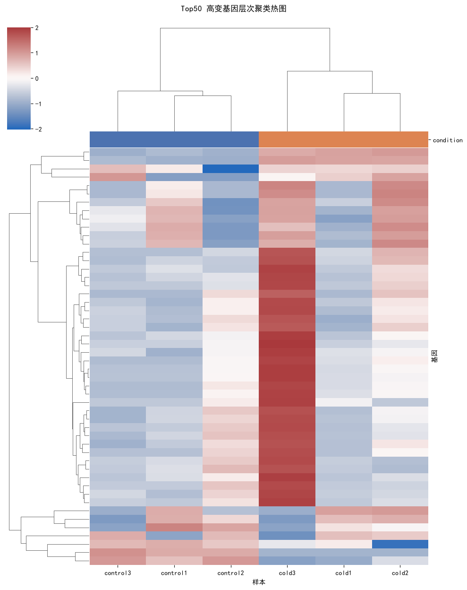
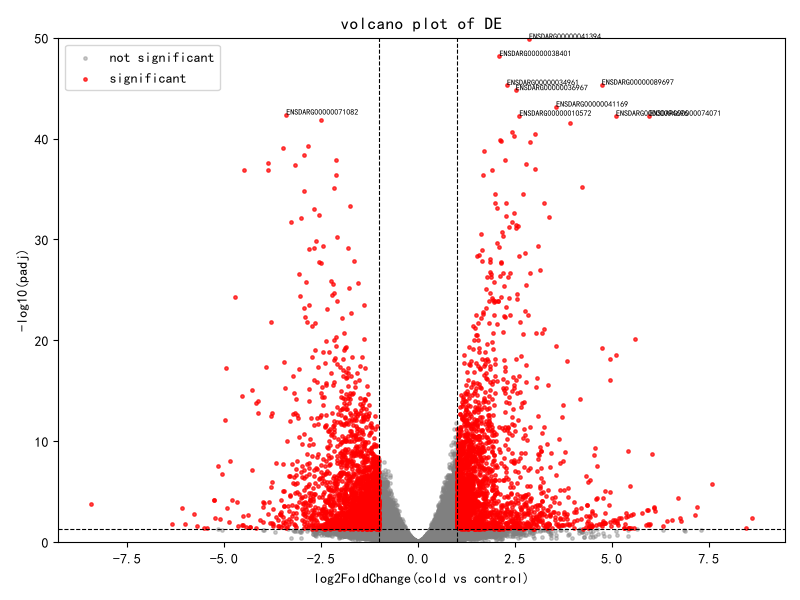
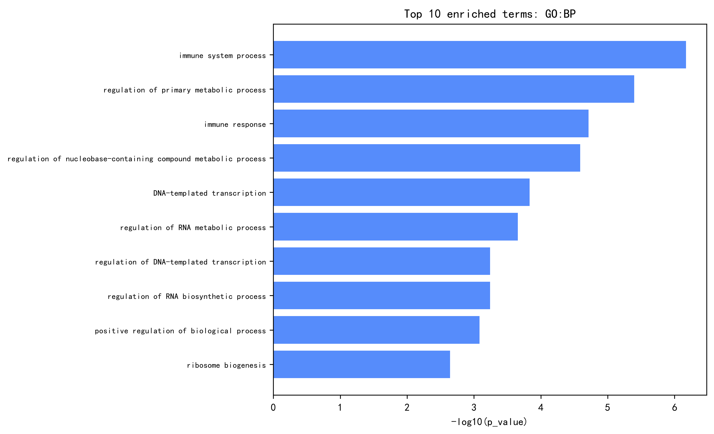

冷应激下的斑马鱼鳃组织的转录组分析
作者: 王奇贤
日期：2026-11-18
数据来源:GSE69965
代码:https://github.com/electric-wqx/my_project_001
说明:学习性分析,在AI（deepseek-v4.1-flash）协助下进行

摘要
为了探究低温应激对鱼类鳃组织转录组的影响，这个项目基于网络公开数据集GSE69965，选取了其中斑马鱼28℃对照组以及8℃12小时低温处理组
，每组三个生物学重复，共六个样本。大致流程是统计样本基因表达文库，主要进行了PCA,层次聚类，差异分析，以及富集处理。结果是共检测到
25329个基因，其中padj<0.05的基因有7696个，满足padj<0.05并且|log2FC|>1的基因共有3986个，其中低温处理组表达上调基因1946个，
表达下调基因2040个。PCA结果显示对照组和处理组在PC1(57.8%)上分离良好，层次聚类结果同样佐证相同结论。最后的GO：BP富集结果显示，
显著基因主要涉及免疫系统过程，免疫应答，代谢调控以及转录调控等生物过程，可以推测低温处理会影响斑马鱼鳃组织的免疫相关转录的过程，
后续需要实验验证。

1.背景以及问题
水温是影响鱼类生理状态的重要环境因子。鳃是鱼类气体交换，渗透压调节的组织。低温胁迫会导致鱼鳃组织的转录组改变，但具体涉及哪些生理
过程，需要结合转录组进行分析。
本项目的问题是：
在8℃低温胁迫12小时后，哪些基因表达会发生显著变化？它们又分布在哪些生物学过程当中？

2.数据与方法

2.1数据来源
https://www.ncbi.nlm.nih.gov/geo/query/acc.cgi?acc=GSE69965
数据集：GSE69965
物种：斑马鱼
组织：鳃
分组：
对照组：28°C，3 个重复（GSM1714078–GSM1714080）
冷应激组：8°C，12 h，3 个重复（GSM1714083、GSM1714084、GSM2176256）
数据类型：RNA-seq raw counts

2.2 数据预处理
去除 featureCounts 的统计行（__no_feature 等）；
去除含缺失值的基因；
保留至少在 3 个样本中有表达的基因；
最终用于分析的基因数为 25329。

2.3 差异表达分析
使用 Python 包 pydeseq2 进行差异表达分析：
设计公式：~condition
对比：cold vs control
显著基因标准：
padj < 0.05 & |log2FoldChange| > 1

2.4 样本结构与可视化
样本 PCA：对 log1p 转换后的高变基因进行标准化，取前 2 个主成分；
样本层次聚类：基于 top 2000 高变基因，Euclidean 距离，ward 方法；
热图：展示 top 50 高变基因，按基因做 z-score；
火山图：横轴为 log2FoldChange，纵轴为 -log10(padj)。

2.5 富集分析
工具：g:Profiler；
物种参数：drerio；
基因列表：padj < 0.05 且 |log2FC| > 1 的显著基因；
富集来源：GO:BP 和 KEGG；
结果按 p_value 排序，并结合 intersection_size 和 term_size 解释。

3.结果

3.1 样本分布情况

3.1.1 样本PCA
图一

斑马鱼 6 个样本的 PCA。每个点为一个样本，颜色表示 control / cold；括号内为 PC1、PC2 的解释方差比例。
PCA 显示，control 组三个重复紧密聚集，cold 组沿 PC1 与 control 明显分离；PC1 和 PC2 分别解释 57.8% 和 19.2% 的变异。
cold3 在 PC2 上偏离其他 cold 样本，是因为存在批次效应。

3.1.2 样本聚类热图
图二

基于top50高变基因的样本聚类热图。列注释表示 control/cold，颜色表示基因表达z-score。
聚类热图显示，control与cold样本在整体表达模式上明显分开；cold3 相对独立，与PCA结果一致。
热图呈现两个主要的基因表达模块：一部分基因在 cold 组高表达、control 组低表达，另一部分则相反。

3.2 差异分析
Python 3.12
pydeseq2 0.5.4
g:Profiler
差异分析用 BH 校正
指标	                                     数量
检测基因数	                             25329
padj < 0.05	                             7696
padj < 0.05 & |log2FoldChange| > 1       3986
cold 组上调	                             1946
cold 组下调	                             2040
结果说明，在冷应激之后，鳃组织出现了大量差异表达的基因，说明转录组发生了比较明显的变化。

3.3 火山图
图三

cold vs control的火山图。横轴为log2FoldChange，纵轴为-log10(padj)。红色点表示同时满足padj<0.05和|log2FC|>1的基因；
竖向虚线为 log2FC = ±1，横向虚线为 padj = 0.05。
图中cold组上调和下调基因均存在，部分基因的校正后p值很小，提示冷应激响应较强。

3.4 GO:BP富集
图四

冷应激显著基因的GO:BP富集结果（top10）。横轴为-log10(p_value)，条形越长表示富集p值越小。
GO:BP 富集显示，显著基因主要涉及：
immune system process（免疫系统过程）
immune response（免疫应答）
regulation of primary metabolic process（初级代谢调控）
regulation of nucleobase-containing compound metabolic process（核酸类代谢调控）
DNA-templated transcription（DNA 模板转录）
regulation of RNA metabolic process（RNA 代谢调控）
其中，immune system process和immune response与冷应激下的免疫响应较为相关；
代谢和转录调控相关术语较为宽泛，提示冷应激伴随广泛的转录和代谢重编程，但不能说明具体调控机制。

3.5 KEGG富集
当前分析中，KEGG 未得到显著富集结果，因此不进行讨论。

4.讨论
在本项目中，冷应激之后鳃组织出现了大量的差异表达基因，PCA以及样本聚类均显示control和cold组整体分开，这可以说明冷应激对于
鳃组织的转录有较明显的影响。GO:BP富集集中在免疫系统，免疫应答，说明冷应激可能会带来鳃组织免疫相关转录的改变，富集结果在代谢调节
的通路中分布，说明冷应激也可能会带来鳃组织代谢调控相关转录的改变。但是结果很宽泛，没法推理更为精细的调节机制。

5.项目局限
5.1 每组只有三个生物学重复
5.2 只分析了鳃组织 并且只采用了12h冷处理的结果
5.3 斑马鱼是广泛研究的鱼类，结果不一定适用于所有鱼类
5.4 cold3存在明显的批次效应

6.结论
冷应激 12 h 后，斑马鱼鳃组织出现大量差异表达基因，样本整体结构显示control与cold组分离；显著基因在免疫系统过程、免疫反应以及代谢/转录调控相关GO:BP术语上富集。
上述结果为后续验证冷应激下鱼类鳃组织免疫和代谢响应提供了候选基因和生物学过程，但仍需实验验证。

